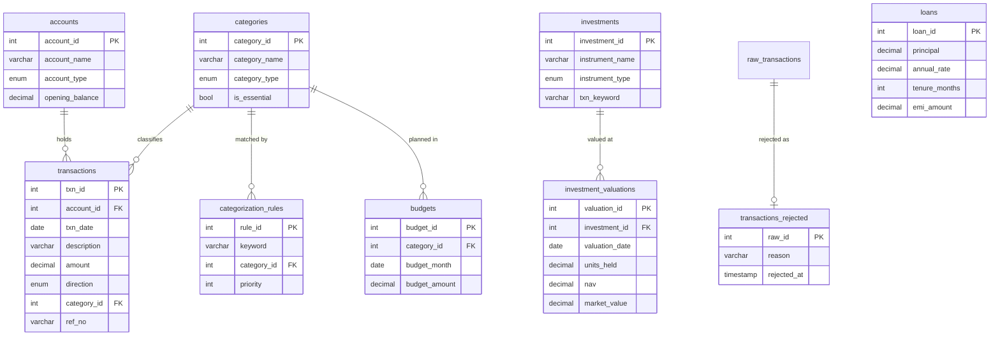

# Personal Finance & Financial Health Analytics

**Author: Satayu Dhal**

An 18-month personal-finance analytics stack where **MySQL does all the work** — cleaning,
deduplication, categorization, KPI logic — and **Excel is a pure presentation layer** over it.

No Python. No ETL framework. SQL and Excel only, deliberately.

```
 data/raw/*.csv ──▶ staging ──▶ core ──▶ 17 analytics views ──▶ Excel (Power Query)
   1,152 rows       all text    typed     KPIs, trends,          PivotCharts, slicers,
                                cleaned   net worth, health      one-click Refresh All
                                          score
```

Rebuild everything, from an empty server to a tested database, with one command:

```
mysql --login-path=finance --local-infile=1 < sql/00_run_all.sql
```

**99 assertions. Zero failures. Non-zero exit code if that ever stops being true.**

---

## Why this exists

Most "personal finance dashboard" projects put the logic in application code and use the
database as a place to park rows. This one inverts that: every KPI definition lives in exactly
one SQL view, so changing a definition changes the dashboard on next refresh, and no number
can drift between the database and the spreadsheet.

The dataset is synthetic but **deliberately hostile** — 25 duplicate rows, three date formats
plus junk, missing amounts, padded mixed-case descriptions, and four merchants no rule
matches. Cleaning that up correctly, and being able to prove it, is the point.

---

## Results

| | |
|---|---|
| **Reconciliation** | 1,152 raw = 1,116 clean + 11 rejected + 25 duplicates — exact, cross-checked |
| **Categorization coverage** | 97.04% (1,083 / 1,116), the 33 leftovers traced to 4 merchants |
| **Net worth, Sep 2026** | ₹2,02,249 (from −₹17,214 at its lowest) |
| **Financial health score** | 82.82 / 100 (range 39.81 – 95.98) |
| **Trailing-12-month savings rate** | 31.18% |
| **Portfolio** | ₹86,156 invested → ₹94,368 (+9.53% absolute, **13.05% XIRR**) |
| **Loan** | 63.53% repaid, amortization closing within ₹2 of zero over 24 months |
| **Idempotency** | identical MD5 fingerprint over all 1,116 rows across repeated rebuilds |
| **Test suite** | 99 assertions across 6 phases |

### The finding worth reading

September 2026 credit-card spend is **₹8,157**, but the card closes owing **₹5,091**.

The difference is two rows rejected during cleaning for unparseable dates — `SPOTIFY INDIA`
₹119 and `FLIPKART/ORDER` ₹2,947. Both were genuinely billed and paid, but neither survived
validation, so neither reached the clean table.

**8,157 − 119 − 2,947 = 5,091.**

A data-quality decision made in the cleaning layer is still visible, and fully explainable, in
a balance-sheet figure four layers downstream. That traceability is the thing this project is
actually demonstrating.

---

## Architecture

Three layers, one direction. Full detail in [`docs/ARCHITECTURE.md`](docs/ARCHITECTURE.md).

| Layer | Contents | Why |
|---|---|---|
| **Staging** | `raw_transactions`, `raw_valuations` — every column VARCHAR | A malformed row can never break the load, and cleaning can always be re-run from the original |
| **Core** | `transactions`, `transactions_rejected`, `investment_valuations` + 6 reference tables | Typed, constrained, deduplicated, categorized — the single source of truth |
| **Analytics** | 17 `vw_*` views | Shaped for Excel: one row per month, `month` as a real DATE, no NULL numerics anywhere |



---

## Setup

**Requires** MySQL 8.0 (Server + Connector/NET) and Excel for Windows with Microsoft 365.

**1. Create the app user** — in Workbench as root:

```sql
CREATE USER 'finance_app'@'localhost' IDENTIFIED BY '<your-password>';
GRANT ALL PRIVILEGES ON finance_db.* TO 'finance_app'@'localhost';
GRANT CREATE ON *.* TO 'finance_app'@'localhost';
SET GLOBAL local_infile = 1;
```

Add `local_infile=ON` under `[mysqld]` in `my.ini` to make that survive a restart.

**2. Store the credentials** so no password ever appears in a script or a repo:

```
mysql_config_editor set --login-path=finance --host=localhost --user=finance_app --password
```

**3. Build** from the repo root:

```
mysql --login-path=finance --local-infile=1 < sql/00_run_all.sql
```

PowerShell has no `<` redirection, so use either:

```
Get-Content sql\00_run_all.sql | mysql --login-path=finance --local-infile=1
cmd /c "mysql --login-path=finance --local-infile=1 < sql\00_run_all.sql"
```

Expect `ALL TESTS PASS`, 99/99. A failure raises `SQLSTATE 45000`, so the command exits
non-zero and a broken build cannot be mistaken for a good one.

**4. The dashboard** — follow [`docs/EXCEL_GUIDE.md`](docs/EXCEL_GUIDE.md), click by click.

---

## The KPIs

Fifteen metrics, each defined once in SQL. Full formulas in
[`docs/ARCHITECTURE.md`](docs/ARCHITECTURE.md) §5; plain-English explanations of what they
mean and why in [`docs/FINANCE_PRIMER.md`](docs/FINANCE_PRIMER.md).

| # | KPI | Healthy band |
|---|---|---|
| 1 | Savings Rate | ≥ 20% |
| 2 | Expense-to-Income | ≤ 70% |
| 3 | Debt-to-Income | ≤ 15% |
| 4 | Investment Rate | ≥ 10% |
| 5 | Net Cash Flow | > 0 |
| 6 | Essential Spend Share | 50–60% |
| 7 | Emergency Fund Coverage | ≥ 6 months |
| 8 | Budget Variance % | ≤ 0% |
| 9 | MoM Expense Growth | — |
| 10a | Recurring Burn | — |
| 10b | Subscription Burn | — |
| 11 | Investment Return (absolute) | — |
| 12 | Investment XIRR | — |
| 13 | Loan Payoff Progress | — |
| 14 | Net Worth | rising |
| 15 | Financial Health Score | ≥ 70 |

Transfers (card payments, wallet top-ups) are excluded from every ratio — and that exclusion is
*proven*, not asserted: both legs of every transfer net to exactly ₹0.00.

---

## SQL worth looking at

| Technique | Where | Problem it solves |
|---|---|---|
| Arithmetic date validation | `03_clean.sql` | `STR_TO_DATE` returns NULL in a `SELECT` but raises a fatal error inside `INSERT` under strict mode — so a validity check built on it dies on the exact row it exists to catch. Validation is pure integer arithmetic instead, across four statements so evaluation order is guaranteed |
| `ROW_NUMBER()` dedupe | `03_clean.sql` | Keeps the *valid* copy of a duplicated transaction, with a stable tie-break so rebuilds are byte-identical |
| Recursive CTE | `05_seed_planning.sql` | Generates 234 budget rows from a 13-row plan, with the month axis derived from the data so it extends itself |
| Recursive CTE | `06_views.sql` | 24-month loan amortization, closing within ₹2 of zero |
| Gaps-and-islands | `06_views.sql` | Detects subscriptions: ≥3 consecutive months at a stable amount |
| Window aggregates | `06_views.sql` | Running balances, category share of month, month-over-month change on a densified grid |
| Cursor + dynamic SQL | `90_tests.sql` | Executes every view to prove it runs, rather than counting rows in `information_schema` |

---

## Testing

`sql/90_tests.sql` grew one block per phase and now runs 99 assertions:

| Phase | Tests | Covers |
|---|---|---|
| 1 | 24 | Staging load, injected defects, reference seed |
| 2 | 18 | Reconciliation, typing, normalization, rejections |
| 3 | 15 | Coverage, transfer integrity, keyword routing |
| 4 | 15 | Budget grid, alignment with actuals, savings goals |
| 5 | 25 | View shape, identities, known totals, recurrence |
| 6 | 2 | Every view executes; suite fails the process on red |

Each assertion prints what it measured next to what it expected, so a failure tells you the
actual value rather than only that something broke. Both failure paths were verified by
deliberately breaking things — which is how a counting bug in the view checker was found and
fixed.

---

## Repository

```
sql/
  00_run_all.sql        rebuild everything, then assert
  01_schema.sql         11 tables + reference seed data
  02_load.sql           CSV -> staging
  03_clean.sql          cleaning + dedupe procedures
  04_categorize.sql     keyword rules -> categories
  05_seed_planning.sql  budgets (recursive CTE) + goals
  06_views.sql          17 analytics views
  90_tests.sql          99 assertions
docs/
  ARCHITECTURE.md       layers, schema, KPI formulas (source of truth)
  BUILD_PLAN.md         phases and acceptance criteria
  DATA_INVENTORY.md     what data exists and where it came from
  EXCEL_GUIDE.md        click-by-click dashboard build
  FINANCE_PRIMER.md     what the KPIs mean, in plain English
  METRICS.md            every reported number + the query that produced it
data/raw/               the fixed source dataset, never edited
excel/                  finance_dashboard.xlsx
```

**Every number in this README appears in [`docs/METRICS.md`](docs/METRICS.md) alongside the
query that produced it.** Nothing here is estimated or remembered.

---

## Known limitations

- **Net worth is negative Jun–Oct 2025.** The ₹72,000 laptop loan is a liability from the month
  it starts, but the laptop is not an asset in this model — the lender paid the vendor, so no
  transaction exists. Net worth drops by the full principal with nothing on the other side.
  The formula is correct; the model is incomplete, and the dip is annotated rather than hidden.
- **33 transactions stay uncategorized** (₹10,990). Three of the four merchants could be
  matched with new rules, lifting coverage to 99.28%. The fourth is a masked UPI handle
  (`UPI/PAY*9348XXXXXX`) whose merchant genuinely cannot be identified — inventing a category
  for it would improve the number and degrade the data.
- **Synthetic data.** Simulated NAVs, not real market prices. See `docs/DATA_INVENTORY.md`.
- **No index helped.** Both candidate indexes were built and benchmarked; at 1,116 rows the
  table sits entirely in the buffer pool and the cost is CPU on window functions, not lookups.
  They were dropped rather than shipped as unjustified tuning.

## Next

- Add the three proposed categorization rules (97.04% → 99.28%), recording coverage before and
  after
- Load real anonymized bank statements into `data/private/` via `02b_load_private.sql`
- Port `06_views.sql` to dbt — `90_tests.sql` maps almost directly onto dbt tests

---

## Credits

**Satayu Dhal** — author.

Built with MySQL 8 and Excel only. Every figure in this README is reproducible by running
`sql/00_run_all.sql` and appears in [`docs/METRICS.md`](docs/METRICS.md) with the query that
produced it.
