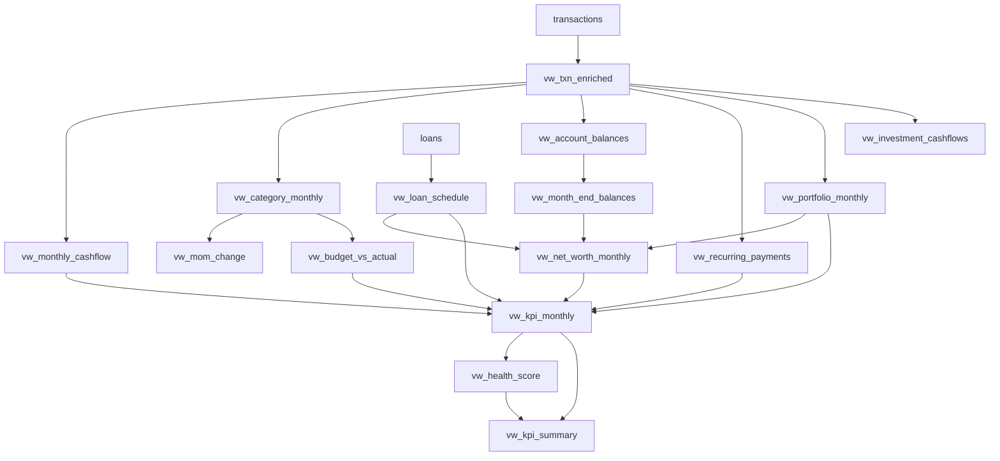

# Project Structure & Working

A complete walkthrough of what is in this repository, what each file does, and how a row of
messy CSV text becomes a number on an Excel tile.

This document is **descriptive** — it explains the code as it stands. For *definitions* (the
authoritative KPI formulas) see [`ARCHITECTURE.md`](ARCHITECTURE.md); for *measured numbers* and
the queries that produced them see [`METRICS.md`](METRICS.md); for the *build order* and
acceptance criteria see [`BUILD_PLAN.md`](BUILD_PLAN.md).

---

## 1. What this project is

An 18-month personal-finance analytics stack (Apr 2025 – Sep 2026) in which **MySQL owns all
logic** — loading, cleaning, deduplication, categorization, KPI arithmetic — and **Excel is a
pure presentation layer** that holds no formulas of consequence.

The stack is deliberately limited to **SQL (MySQL 8) and Excel**. No Python, no PowerShell, no
VBA, no ETL framework. Automation is done with SQL (`SOURCE`, stored procedures) and Excel
features (Power Query, PivotTables, slicers). This constraint is recorded in
[`../CLAUDE.md`](../CLAUDE.md) and is a design choice, not an oversight.

The central idea: **each KPI is defined exactly once, in exactly one SQL view.** Changing a
definition in `sql/06_views.sql` changes the dashboard on the next refresh. No number can drift
between the database and the spreadsheet, because the spreadsheet never computes one.

The dataset is synthetic but **deliberately hostile**: 25 duplicate rows, three date formats plus
junk, missing amounts, padded mixed-case descriptions, and four merchants no rule matches.
Cleaning it correctly — and being able to *prove* the cleaning was correct — is the point of the
exercise.

---

## 2. Repository map

```
finance-dashboard/
├── CLAUDE.md                  Project rules: stack limits, conventions, run commands
├── README.md                  Headline results and setup summary
├── .gitignore                 Excludes *.cnf, data/private/, Excel lock files
│
├── data/
│   └── raw/                   THE FIXED SOURCE DATASET — never edited
│       ├── raw_transactions.csv    1,152 rows · txn_date, description, debit, credit,
│       │                           account_name, ref_no
│       └── raw_valuations.csv      70 rows · instrument_name, valuation_date, units_held, nav
│
├── sql/                       Numbered, run in order, every file re-runnable
│   ├── 00_run_all.sql         Orchestrator: SOURCEs 01→06 then 90
│   ├── 01_schema.sql          DROP/CREATE finance_db · 11 tables · reference seed
│   ├── 02_load.sql            LOAD DATA LOCAL INFILE → staging (all VARCHAR)
│   ├── 03_clean.sql           sp_clean_transactions, sp_clean_valuations → core
│   ├── 04_categorize.sql      sp_categorize · vw_uncategorized_review
│   ├── 05_seed_planning.sql   Budgets (recursive CTE) · savings goals
│   ├── 06_views.sql           16 of the 17 analytics views
│   └── 90_tests.sql           99 assertions · hard-fails the process on red
│
├── docs/
│   ├── ARCHITECTURE.md        Layers, schema, view catalogue, KPI formulas — SOURCE OF TRUTH
│   ├── BUILD_PLAN.md          10 phases with acceptance numbers
│   ├── DATA_INVENTORY.md      What data exists, where it came from, what you must supply
│   ├── EXCEL_GUIDE.md         Click-by-click dashboard build (ODBC connection, Data Model)
│   ├── FINANCE_PRIMER.md      What each KPI means, in plain English
│   ├── METRICS.md             Every reported number + the query that produced it
│   ├── KICKOFF_PROMPT.md      Per-phase prompts used during the build
│   ├── RESUME_BULLETS.md      Written only from METRICS.md
│   └── PROJECT_STRUCTURE.md   This file
│
└── excel/
    └── finance_dashboard.xlsx The presentation layer (~3.4 MB)
```

**`data/private/`** does not exist yet. It is gitignored and reserved for real anonymized bank
exports (Phase 9).

---

## 3. The three layers

```
 SOURCES              STAGING                CORE                    ANALYTICS            EXCEL
 ───────              ───────                ────                    ─────────            ─────
 raw_transactions ──▶ raw_transactions  ──▶  transactions       ──▶  17 vw_* views  ──▶  Power Query
 raw_valuations   ──▶ raw_valuations         transactions_rejected   KPIs, net worth,     (ODBC)
                                             investment_valuations   health score,         ↓
 (later: your own     all columns VARCHAR     + 6 reference tables   data quality         Data Model
  statements in       loaded as-is                                                         ↓
  data/private/)                                                                      PivotCharts
                      ▲                      ▲                      ▲                 + slicers
                   02_load.sql            03_clean.sql           06_views.sql
                                          04_categorize.sql
                                          05_seed_planning.sql

                              90_tests.sql validates every layer
```

| Layer | Why it exists |
|---|---|
| **Staging** | Every column is `VARCHAR`, so a malformed row can never abort the load, and cleaning can always be re-run from the untouched original. |
| **Core** | Typed, constrained, deduplicated, categorized. The single source of truth. Records only what is actually known — `category_id IS NULL` means "unknown", not "miscellaneous". |
| **Analytics** | Views shaped for Excel. Excel therefore never duplicates KPI logic in cell formulas. |

Data flows in **one direction only**. Nothing downstream writes back.

---

## 4. The run contract

```bash
Get-Content sql\00_run_all.sql | mysql --login-path=finance --local-infile=1
```

Four non-obvious rules govern how this must be invoked:

1. **Run from the repo root.** Both `SOURCE` and `LOAD DATA LOCAL INFILE` resolve their paths
   against the *client's* working directory, not the server's.
2. **Do not name a database on the command line.** `01_schema.sql` drops and recreates
   `finance_db`, so passing `finance_db` as the default schema fails with *Unknown database* on a
   fresh machine before a single statement runs. Each file opens with its own `USE finance_db;`.
3. **`--local-infile=1` is required** for `02_load.sql`, and the server needs
   `SET GLOBAL local_infile = 1` (or `local_infile=ON` in `my.ini` to survive a restart).
4. **`SOURCE` lines take no trailing semicolon** — it would be parsed as part of the filename.

Credentials live in a `mysql_config_editor` login path named `finance`. No password appears in
any script, in any file, or in this repository.

**Idempotency.** Every script is re-runnable and converges on the same state. `01_schema.sql`
drops the database; `02_load.sql` truncates staging; the cleaning, categorization and planning
procedures truncate or clear their own targets before writing; the views are
`CREATE OR REPLACE`. Repeated rebuilds produce identical row counts and identical `txn_id`s —
verified by an MD5 fingerprint over all 1,116 clean rows.

---

## 5. File-by-file walkthrough

### `01_schema.sql` — structure and reference data

Drops and recreates `finance_db` (utf8mb4 / `utf8mb4_0900_ai_ci`), then creates **11 tables** and
seeds all reference data:

- 3 accounts — SBI Savings (opening ₹25,000), HDFC Credit Card (₹0), Paytm Wallet (₹500)
- 23 categories across 5 `category_type`s, each flagged `is_essential` or not
- 48 `categorization_rules` — keyword → category, with a `priority` (lower wins)
- 5 investments, each carrying a `txn_keyword` that links its buy transactions to the holding
- 1 loan — Bajaj Finserv laptop loan, ₹72,000 @ 14% p.a., 24 months from 2025-06-01, EMI ₹3,457

Constraints worth noting: `transactions.amount` carries `CHECK (amount > 0)` (sign is expressed
by `direction`, never by a negative amount), and `investment_valuations.market_value` is a
**generated stored column** `ROUND(units_held * nav, 2)` — so it can never disagree with its
inputs and is never inserted.

### `02_load.sql` — CSV into staging

Truncates both staging tables, then two `LOAD DATA LOCAL INFILE` statements with
`FIELDS TERMINATED BY ','`, `OPTIONALLY ENCLOSED BY '"'`, `IGNORE 1 LINES`.

It then prints a **load profile** whose expected values sit in comments next to each query:
1,152 raw rows · 70 valuations · 25 duplicate `(account_name, ref_no)` pairs · 6 bad dates · 5
missing amounts · 0 rows with a stray carriage return. This makes a bad load visible immediately
rather than three files later.

### `03_clean.sql` — staging into core

The most intricate file in the repo. It creates `transactions_rejected`, then two procedures.

**Why procedures and never functions:** with binary logging enabled, MySQL refuses
`CREATE FUNCTION` unless the account holds `SUPER`/`SET_USER_ID` or the server sets
`log_bin_trust_function_creators`. Keeping to procedures lets the repo rebuild on any MySQL 8
with an ordinary account and no server-side configuration.

**`sp_clean_transactions()`** — the date problem and its solution:

> `STR_TO_DATE('31-02-2026','%d-%m-%Y')` returns `NULL` with a warning inside a plain `SELECT`,
> but under strict `sql_mode` the identical call raises **ERROR 1411** inside
> `INSERT`/`UPDATE`/`CREATE…SELECT`. A validity check built on it therefore *aborts on the very
> row it exists to catch.*

So validation is pure integer arithmetic, split across four statements so evaluation order is
guaranteed and no expression ever sees input it has not already been proven safe for:

| Step | What it does | Why it cannot throw |
|---|---|---|
| 1 | `REGEXP` picks the format, `SUBSTRING` splits out y/m/d; descriptions normalized to `UPPER(TRIM())` with internal whitespace runs collapsed to one space; amount and `direction` derived from whichever of `debit`/`credit` is populated | Every `CAST` is guarded by its own `REGEXP`, so malformed input becomes `NULL` instead of aborting the statement. Separators are matched strictly — `12-05/2026` is rejected, not silently accepted |
| 2 | Month length taken from `DAY(LAST_DAY(…-01))`, only for rows with month 1–12 and year 1900–2999 | The 1st of a month is valid by construction |
| 3 | The `DATE` is built **only** where the day fits that month's length | `31-02-2026` never reaches a date constructor |
| 4 | First failing check wins, assigning exactly one `reason` | — |

Rejection reasons, in precedence order: `bad_date`, `missing_amount`, `non_positive_amount`,
`unknown_account`, `blank_description`, `missing_ref_no`. Because the first failing check wins,
the per-reason counts sum exactly to the rejected total.

**Deduplication** then runs on `(account_id, ref_no)` with
`ROW_NUMBER() OVER (PARTITION BY account_id, ref_no ORDER BY is_valid DESC, raw_id)`:

- `is_valid DESC` puts a good row ahead of a defective twin — the **valid** copy is kept
- `raw_id` is a stable tie-break, so the choice is identical across rebuilds
- rows with a `NULL` key are forced to `rn = 1`, because a window partition groups all `NULL`s
  together and would otherwise mark every key-less row after the first as a duplicate of an
  unrelated row

Dispatch is then mechanical: `rn = 1` and valid → `transactions`; `rn = 1` and invalid →
`transactions_rejected` with its reason; `rn > 1` → dropped as a duplicate.

**Duplicates are not recorded in `transactions_rejected`**, deliberately: a duplicate is not a
defective row, it is a second copy of one already kept. The count stays derivable as
`raw − clean − rejected`, which is exactly how `vw_data_quality` reports it.

**Reconciliation:** 1,152 raw = **1,116 clean + 11 rejected + 25 duplicates**. The 11 rejections
are 6 `bad_date` + 5 `missing_amount`.

`sp_clean_valuations()` applies the same staged, guard-before-cast approach to the valuations
file, joined to `investments` on `instrument_name`.

### `04_categorize.sql` — keyword rules into categories

`sp_categorize()` first clears **every** `category_id`, so re-running after a rule change
recategorizes from scratch rather than layering onto stale assignments. It then matches rules as
substrings against the already-normalized description (`LIKE CONCAT('%', keyword, '%')`) — the
`LIKE` never has to cope with casing or padding, because `03_clean.sql` handled that.

A transaction can match several rules, so the winner is ranked deterministically:

1. `priority ASC` — lower wins, per the schema comment
2. `LENGTH(keyword) DESC` — a longer keyword is a more specific merchant
3. `rule_id` — stable tie-break

On the shipped data no transaction matches more than one rule, so ranks 2 and 3 never fire. They
exist because new rules and real statements (Phase 9) make overlap the norm, and without a
deterministic order the same input could categorize differently between runs.

**Coverage: 1,083 of 1,116 = 97.04%.** The 33 leftovers come from exactly 4 merchants, surfaced
by `vw_uncategorized_review` (defined in this file, next to the rules that leave it non-empty).

A `NULL` `category_id` is the uncategorized marker and is kept in core rather than pointed at a
placeholder category row. Bucketing uncategorized debits as "Uncategorized" expenses is a
*presentation* concern, handled one layer up.

### `05_seed_planning.sql` — budgets and goals

13 budgeted categories × 18 months = **234 rows**, generated by a recursive CTE rather than
hand-typed. Three pieces:

- `bounds` anchors on the first and last month that actually have transactions
- `months` recurses `budget_month + INTERVAL 1 MONTH` until the last — 18 iterations, far inside
  the default `cte_max_recursion_depth` of 1000
- `plan` holds the 13 amounts in **one place**, so editing the budget is a 13-line edit, not 234
  `INSERT`s

The month axis is **derived from the data, not hardcoded**: loading a longer statement history
extends the budget automatically instead of silently leaving new months unbudgeted — which would
read as a 100% favourable variance. The `CROSS JOIN` against `plan` produces the 234 rows; the
`JOIN categories` resolves names and drops anything misspelled, which the 234-row assertion then
catches.

Total budget: ₹26,000/month × 18 = ₹468,000.

Savings goals: Emergency Fund ₹150,000 by 2027-03-31, Laptop Upgrade ₹60,000 by 2027-06-30.
`saved_amount` is left at 0 on purpose — progress is derived from actual balances in the
analytics layer, not stored as a second copy that would drift from the transactions it summarizes.

### `06_views.sql` — the analytics layer

16 views, built bottom-up so each depends only on earlier ones. Discussed in §7.

### `90_tests.sql` — the gate

99 assertions. Discussed in §9.

---

## 6. Table reference

| Table | Layer | Grain | Notes |
|---|---|---|---|
| `raw_transactions` | staging | 1 per exported line | all `VARCHAR`; 1,152 rows |
| `raw_valuations` | staging | instrument × month-end | all `VARCHAR`; 70 rows |
| `accounts` | reference | 1 per account | `account_type`, `opening_balance` |
| `categories` | reference | 1 per category | `category_type` ∈ income/expense/investment/debt/transfer; `is_essential` |
| `categorization_rules` | reference | keyword → category | 48 rules, `priority` ascending wins |
| `transactions` | core | 1 per real transaction | `amount > 0`, direction carries the sign; `category_id` nullable |
| `transactions_rejected` | core | 1 per rejected raw row | created in `03_clean.sql`; `raw_id` + `reason` |
| `investments` | reference | 1 per holding | `txn_keyword` links buys to the holding |
| `investment_valuations` | core | holding × month-end | `market_value` is a generated stored column |
| `loans` | reference | 1 per loan | `txn_keyword` links EMI transactions |
| `budgets` | planning | category × month | `budget_month` always the 1st |
| `savings_goals` | planning | 1 per goal | `saved_amount` intentionally 0 |

11 tables are created by `01_schema.sql`; `transactions_rejected` is added by `03_clean.sql`, for
12 in total.

---

## 7. View reference and dependency order

All 17 views honour the **Excel contract** from `CLAUDE.md`: one row per month (or month ×
category), `month` is a real `DATE` on the 1st, every numeric column is `COALESCE`d so Power
Query never sees a `NULL` to guess a type from, and names are `snake_case`.



| # | View | Grain | What it does / technique |
|---|---|---|---|
| 1 | `vw_txn_enriched` | transaction | The base. Resolves account, category, `category_type`, `is_essential`, `month`, and `signed_amount`. Buckets uncategorized debits as `'Uncategorized'` expenses |
| 2 | `vw_monthly_cashflow` | month | The KPI numerators and denominators, by conditional aggregation: income, expenses, essential_expenses, debt_service, invested, transfers_excluded, uncategorized_spend, net_cash_flow |
| 3 | `vw_category_monthly` | month × category | Spend per category plus share of month — a window aggregate over an aggregate, `SUM(SUM(amount)) OVER (PARTITION BY month)` |
| 4 | `vw_mom_change` | month × category | `LAG()` month-over-month on a **densified** grid |
| 5 | `vw_budget_vs_actual` | month × category | Budget, actual, variance, variance %, status (Over / On track ≥90% / Under) |
| 6 | `vw_account_balances` | account × transaction | Running balance = `opening_balance + SUM(signed_amount) OVER (PARTITION BY account ORDER BY txn_date, txn_id)` |
| 7 | `vw_month_end_balances` | account × month | Closing balance on a full account × month grid, carrying the last known balance forward |
| 8 | `vw_recurring_payments` | merchant | Subscriptions and EMIs **detected**, not listed: ≥3 consecutive months within ±10%, via gaps-and-islands |
| 9 | `vw_loan_schedule` | loan × installment | 24-row amortization by **recursive CTE** |
| 10 | `vw_portfolio_monthly` | holding × month | Cost basis (running `SUM`) vs market value, on a densified grid; buys matched via `txn_keyword` |
| 11 | `vw_investment_cashflows` | dated cash flow | Buys negative, latest valuation positive — feeds Excel `XIRR()` |
| 12 | `vw_net_worth_monthly` | month | liquid + investments − card outstanding − loan outstanding |
| 13 | `vw_kpi_monthly` | month | **The dashboard feed.** Every KPI, 33 columns, one row per month |
| 14 | `vw_health_score` | month | Composite 0–100 and its five components |
| 15 | `vw_kpi_summary` | 1 row | Trailing-12-month + all-time + latest-month snapshot, for the tiles |
| 16 | `vw_data_quality` | 1 row | Raw / clean / rejected / duplicate counts and coverage % |
| 17 | `vw_uncategorized_review` | merchant | Uncategorized merchants by count and amount (defined in `04_categorize.sql`) |

### The sign convention

Fixed once in `vw_txn_enriched` and relied on everywhere:

```
signed_amount = +amount for a credit, −amount for a debit
```

For a credit card this means **spending drives the balance negative** and a payment moves it back
toward zero, so the amount *owed* is `−balance`. The shipped data closes at `−5091.00` on the
card, i.e. ₹5,091 outstanding. Getting this backwards would silently invert net worth, so
`vw_net_worth_monthly` negates in **exactly one place**.

### Five decisions worth understanding

These are the places where the obvious implementation is wrong:

**Densification before `LAG()`.** `vw_mom_change` builds a full month × category grid and
left-joins actuals before applying `LAG()`. Without it, `LAG()` would step *over* a month in
which a category had no spend and compare March to January while labelling the result
"month over month". Entertainment has 4 transactions in 18 months, so the gaps are real.

**Aggregate before joining budgets.** `vw_budget_vs_actual` aggregates actuals to
(month, category) *before* the join. Joining `budgets` straight to transactions would fan every
transaction across the 18 budget rows for its category and inflate every actual 18×.

**Grid-based month-end balances.** `vw_month_end_balances` carries the last known balance forward
across a full account × month grid instead of picking the final row of each month. Every account
transacts in all 18 months of the shipped data, so the two agree today — but real statements will
have quiet months, where the row-picking version drops the row and breaks net worth.

**Recurring vs subscription burn.** The recurrence detector legitimately finds rent and the phone
recharge. Reporting that total as "Subscription Burn" would put ₹6,500 of rent inside a tile
people read as cancellable spend. So the KPI is split: `recurring_burn` is the full figure
(₹8,007), `subscription_burn` keeps only non-essential categories — the discretionary spend you
could actually cancel (₹1,158).

**Trailing-12-month ratios from sums, not averaged ratios.** `vw_kpi_summary` computes TTM ratios
from summed numerators and denominators. Averaging twelve monthly ratios would weight a month
with ₹8,000 of income the same as one with ₹60,000 and quietly overstate a lumpy freelance year.

---

## 8. The KPIs

Fifteen metrics, each defined once. Formulas are authoritative in
[`ARCHITECTURE.md`](ARCHITECTURE.md) §5; plain-English meaning in
[`FINANCE_PRIMER.md`](FINANCE_PRIMER.md).

| # | KPI | Formula | Healthy band |
|---|---|---|---|
| 1 | Savings Rate | (income − expenses − debt_service) / income | ≥ 20% |
| 2 | Expense-to-Income | expenses / income | ≤ 70% |
| 3 | Debt-to-Income | debt_service / income | ≤ 15% |
| 4 | Investment Rate | invested / income | ≥ 10% |
| 5 | Net Cash Flow | income − expenses − debt_service − invested | > 0 |
| 6 | Essential Spend Share | essential expenses / expenses | 50–60% |
| 7 | Emergency Fund Coverage | liquid balance / avg(essential + debt_service, trailing 3 mo) | ≥ 6 months |
| 8 | Budget Variance % | (actual − budget) / budget | ≤ 0% |
| 9 | MoM Expense Growth | (expenses − LAG(expenses)) / LAG(expenses) | — |
| 10a | Recurring Burn | all detected recurring non-EMI payments | — |
| 10b | Subscription Burn | recurring non-EMI payments in non-essential categories | — |
| 11 | Investment Return | (market value − cost basis) / cost basis | — |
| 12 | Investment XIRR | Excel `XIRR()` over `vw_investment_cashflows` | — |
| 13 | Loan Payoff Progress | principal repaid / principal | — |
| 14 | Net Worth | liquid + investments − card − loan | rising |
| 15 | Financial Health Score | weighted 0–100, below | ≥ 70 |

**Every ratio divides through `NULLIF(x, 0)` and is then `COALESCE`d**, so a month with no income
yields 0 rather than a `NULL` or a division error.

**Transfers (`Card Payment`, `Wallet Top-up`) are excluded from every ratio** — and the exclusion
is *proven*, not asserted: both legs of every transfer net to exactly ₹0.00, which `90_tests.sql`
checks. Transfers are still reported in `transfers_excluded` so the dashboard can show how much
was moved without it touching a ratio. Balances *do* include transfers — a balance that ignored
them would simply be wrong.

**Financial Health Score.** Each component is linearly clamped to 0–1 with `GREATEST`/`LEAST`,
then weighted:

| Component | Points | Full marks at | Zero at |
|---|---|---|---|
| Savings rate | 25 | ≥ 20% | ≤ 0% |
| Debt-to-income | 20 | ≤ 10% | ≥ 40% |
| Emergency months | 25 | ≥ 6 | 0 |
| Investment rate | 15 | ≥ 15% | 0% |
| Budget adherence | 15 | 100% of categories at/under budget | 0% |

---

## 9. The test suite

`sql/90_tests.sql` grew one block per build phase and now runs **99 assertions**. Results
accumulate in a temporary table of `(phase, test, actual, expected)`, and every output row prints
what it measured next to what it expected — so a failure tells you the actual value, not merely
that something broke.

| Phase | Tests | Covers |
|---|---|---|
| 1 | 24 | Staging load, injected defects, reference seed |
| 2 | 18 | Reconciliation, typing, normalization, rejections |
| 3 | 15 | Coverage, transfer integrity, keyword routing |
| 4 | 15 | Budget grid, alignment with actuals, savings goals |
| 5 | 25 | View shape, identities, known totals, recurrence |
| 6 | 2 | Every view executes; suite fails the process on red |

Two procedures carry the parts that a flat `SELECT` cannot express.

**`sp_check_views_selectable()`** — a view can exist in `information_schema` and still fail the
moment it is queried: a column renamed underneath it, a dropped dependency, a stale definition
after a partial rebuild. Counting rows in `information_schema.VIEWS` proves none of that, so this
procedure opens a cursor over every view and **actually executes each one** via `PREPARE` /
`EXECUTE`. Details that matter:

- `COUNT(*) INTO` rather than `SELECT … LIMIT 1` — returns no result set to the client (keeping
  the suite's output clean) and always returns exactly one row, so an empty view cannot trip the
  cursor's `NOT FOUND` handler and end the loop early
- the `SQLEXCEPTION` handler is scoped to one loop iteration, so a single broken view is recorded
  and the loop carries on to test the rest
- `v_err` is a **flag, not a counter**: a broken view fails `PREPARE`, after which `EXECUTE` and
  `DEALLOCATE` would each fail again, scoring one bad view as three. Guarding on the flag also
  avoids leaking a prepared statement when `EXECUTE` is what failed

> This is how a counting bug in the view checker was found — by deliberately breaking a view and
> checking that the suite reported exactly one failure.

**`sp_assert_suite_passed()`** — without it the client exits 0 whatever the result table said, so
a broken rebuild looks successful to any script, CI step, or anyone skimming 100+ rows of output.
It raises `SIGNAL SQLSTATE '45000'` when anything failed, which gives `mysql` a **non-zero exit
code**. It prints nothing when the suite is green.

Expect `ALL TESTS PASS` and 99/99.

---

## 10. The Excel layer

Full click-by-click instructions: [`EXCEL_GUIDE.md`](EXCEL_GUIDE.md).

**Connect over ODBC, not the native MySQL connector.** Excel's *Get Data → From Database → From
MySQL Database* entry does not appear even with Connector/NET correctly installed and registered
in the GAC and `machine.config` — a long-standing detection failure
([MySQL bug #79616](https://bugs.mysql.com/bug.php?id=79616)), compounded by Connector/NET's
year-based 26.x versioning falling outside the assembly range Power Query probes. ODBC is the
documented workaround and is functionally identical: refresh, Data Model, PivotCharts, slicers
and query folding all behave the same.

Install **MySQL Connector/ODBC 64-bit**, then Data → Get Data → From Other Sources → From ODBC,
DSN `(None)`, connection string:

```
Driver={MySQL ODBC 26.7 Unicode Driver};SERVER=localhost;PORT=3306;DATABASE=finance_db;
```

Use the **Unicode** driver — ANSI mangles `₹` and anything outside Latin-1.

14 views are loaded. All 14 go into the **Data Model** (this is what lets one timeline filter
every chart); the seven that cell formulas read directly are additionally loaded as worksheet
Tables; the rest are *Only Create Connection*, which keeps 1,116 transaction rows off a worksheet
and the file small.

| Sheet | Contents |
|---|---|
| `Dashboard` | Timeline + account/category slicers · 6 KPI tiles with deltas and conditional colour · 6 charts · top-10 merchants |
| `Budget` | PivotTable on `vw_budget_vs_actual` with icon sets |
| `Investments` | Portfolio table, `XIRR()` cell, amortization table |
| `Data_*` | One sheet per Power Query table (hidden or grouped) |
| `Data_Quality` | `vw_data_quality` + `vw_uncategorized_review` |
| `About` | KPI definitions, refresh steps, data-source note |

**Data → Refresh All** updates everything. The only real arithmetic Excel performs is `XIRR()`,
which has no MySQL equivalent — and it reads a view purpose-built to feed it.

---

## 11. Conventions (from `CLAUDE.md`)

Rules that the code follows throughout, and that any extension must keep:

- **SQL and Excel only.** If something seems to need another tool, say so and propose a SQL/Excel
  way.
- **Never edit `data/raw/`.** It is the fixed source dataset.
- Descriptions arrive in mixed case with stray whitespace: always match on
  `UPPER(TRIM(description))`.
- Dates arrive in `dd-mm-yyyy`, `dd/mm/yyyy`, `yyyy-mm-dd`, plus junk. Pick the format with
  `REGEXP`, and reject anything that does not round-trip.
- Deduplicate on `(account_name, ref_no)`; keep the valid copy.
- Transfers are excluded from income/expense KPIs. Uncategorized debits count as expenses.
- Scripts are numbered and re-runnable; a new phase adds a new numbered file.
- **Every phase ends by running `sql/90_tests.sql`; all checks must return PASS.**
- After each phase, append the measured numbers to `docs/METRICS.md` **with the query that
  produced them**. Resume bullets are written only from that file.
- Keep views Excel-friendly: one row per month, `month` as a `DATE`, no NULL numerics,
  `snake_case`.

Credentials: the password lives only in the `finance` login path. Never ask for it, print it, or
commit it. `.gitignore` excludes `*.cnf`, `data/private/`, and Excel lock files.

---

## 12. Headline results

Every figure below appears in [`METRICS.md`](METRICS.md) alongside the query that produced it.

| | |
|---|---|
| Reconciliation | 1,152 raw = 1,116 clean + 11 rejected + 25 duplicates |
| Categorization coverage | 97.04% (1,083 / 1,116); 33 leftovers from 4 merchants |
| Net worth, Sep 2026 | ₹2,02,249 (from −₹17,214 at its lowest) |
| Financial health score | 82.82 / 100 (range 39.81 – 95.98) |
| TTM savings rate | 31.18% |
| Portfolio | ₹86,156 invested → ₹94,368 (+9.53% absolute, 13.05% XIRR) |
| Loan | 63.53% repaid; amortization closes within ₹2 of zero over 24 months |
| Idempotency | identical MD5 fingerprint over all 1,116 rows across rebuilds |
| Test suite | 99 assertions, 0 failures |

### The traceability result

September 2026 credit-card spend is **₹8,157**, but the card closes owing **₹5,091**.

The difference is two rows rejected during cleaning for unparseable dates — `SPOTIFY INDIA` ₹119
and `FLIPKART/ORDER` ₹2,947. Both were genuinely billed and paid, but neither survived
validation, so neither reached the clean table.

```
8,157 − 119 − 2,947 = 5,091
```

A data-quality decision made in the cleaning layer is still visible, and fully explainable, in a
balance-sheet figure four layers downstream. That traceability is what the project is actually
demonstrating.

---

## 13. Known limitations

- **Net worth is negative Jun–Oct 2025.** The ₹72,000 laptop loan is a liability from the month
  it starts, but the laptop is not an asset in this model — the lender paid the vendor, so no
  transaction exists. Net worth drops by the full principal with nothing on the other side. The
  formula is correct; the model is incomplete, and the dip is annotated rather than hidden.
- **33 transactions stay uncategorized** (₹10,990). Three of the four merchants could be matched
  with new rules, lifting coverage to 99.28%. The fourth is a masked UPI handle
  (`UPI/PAY*9348XXXXXX`) whose merchant genuinely cannot be identified — inventing a category for
  it would improve the number and degrade the data.
- **Synthetic data.** Simulated NAVs, not real market prices. See
  [`DATA_INVENTORY.md`](DATA_INVENTORY.md) §E for how to substitute real AMFI/NSE history.
- **No index helped.** Both candidate indexes were built and benchmarked; at 1,116 rows the table
  sits entirely in the buffer pool and the cost is CPU on window functions, not lookups. They
  were dropped rather than shipped as unjustified tuning.
- **`90_tests.sql` asserts the shipped dataset's exact counts** (1,152 / 1,116 / 25 / 97.04%).
  Loading different data will turn those assertions red; they need rewriting as *properties*
  (`clean + rejected + duplicates = raw`) rather than literals before the suite is useful against
  real statements.
- **`transactions.uq_dedupe` is `(account_id, txn_date, amount, ref_no)`**, which is a weaker key
  than the `(account_id, ref_no)` the cleaning procedure actually dedupes on. The procedure
  guarantees the stronger invariant before insert, so the constraint is a backstop rather than
  the enforcement point. Worth tightening if rows are ever inserted by any path other than
  `sp_clean_transactions()`.

---

## 14. Extension points

| You want to | Change this |
|---|---|
| Add a categorization rule | The `plan`-style `UNION ALL` block in `01_schema.sql`, then re-run `04` (it clears and recategorizes from scratch) |
| Change a budget amount | The 13-row `plan` CTE in `05_seed_planning.sql` — one place, not 234 `INSERT`s |
| Change a KPI definition | The single view in `06_views.sql` that defines it; Excel follows on Refresh All |
| Re-weight the health score | `vw_health_score` in `06_views.sql`, and §5 of `ARCHITECTURE.md` to keep the doc honest |
| Add an account or holding | The seed `INSERT`s in `01_schema.sql`; holdings need a `txn_keyword` that matches their buy descriptions |
| Rename the database | 8 code sites: `01_schema.sql:7-9`, the `USE finance_db;` headers of `02`–`06` and `90`, plus the `information_schema` filters at `06_views.sql:667` and `90_tests.sql:490` |
| Load your own statements | Export to `data/private/` (gitignored), write `sql/02b_load_private.sql` mapping your bank's columns onto `raw_transactions(txn_date, description, debit, credit, account_name, ref_no)`, then re-run `03` → `06`. Everything downstream is column-name-driven |
| Use real NAVs | `DATA_INVENTORY.md` §E2–E3 — AMFI NAV history and NSE/BSE closes into `raw_valuations` |

Planned next steps are listed at the end of [`../README.md`](../README.md).
